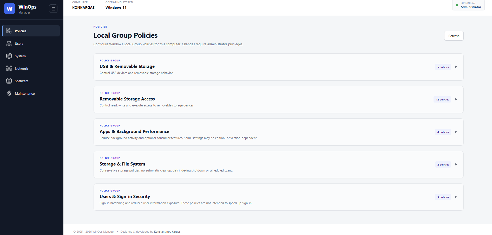
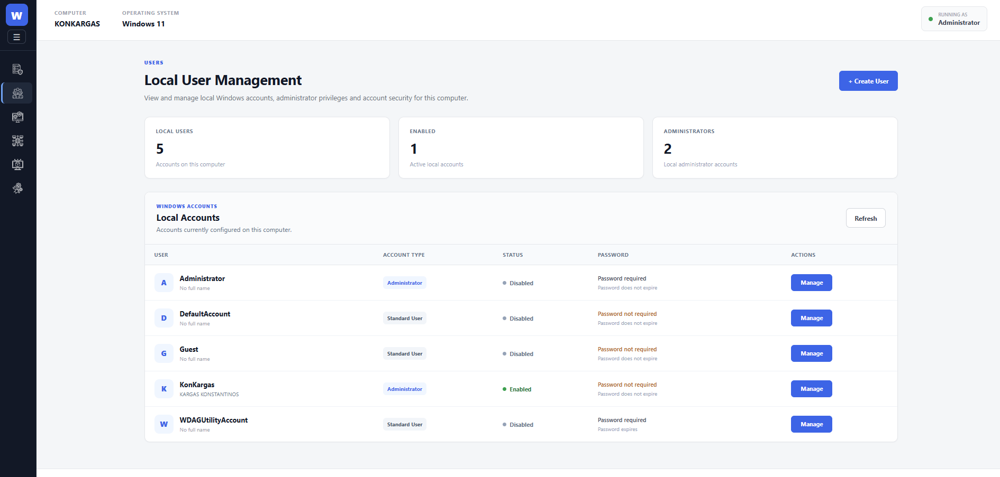
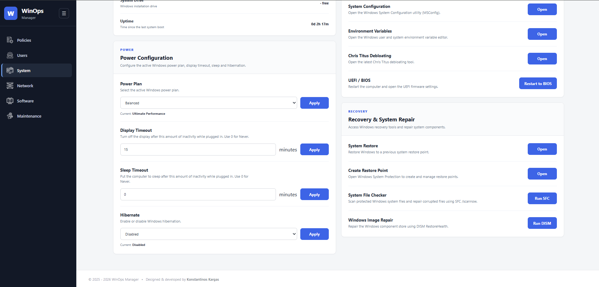
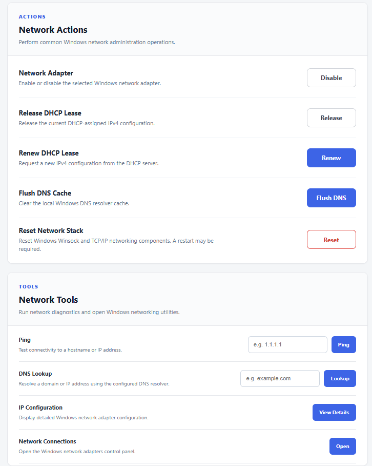
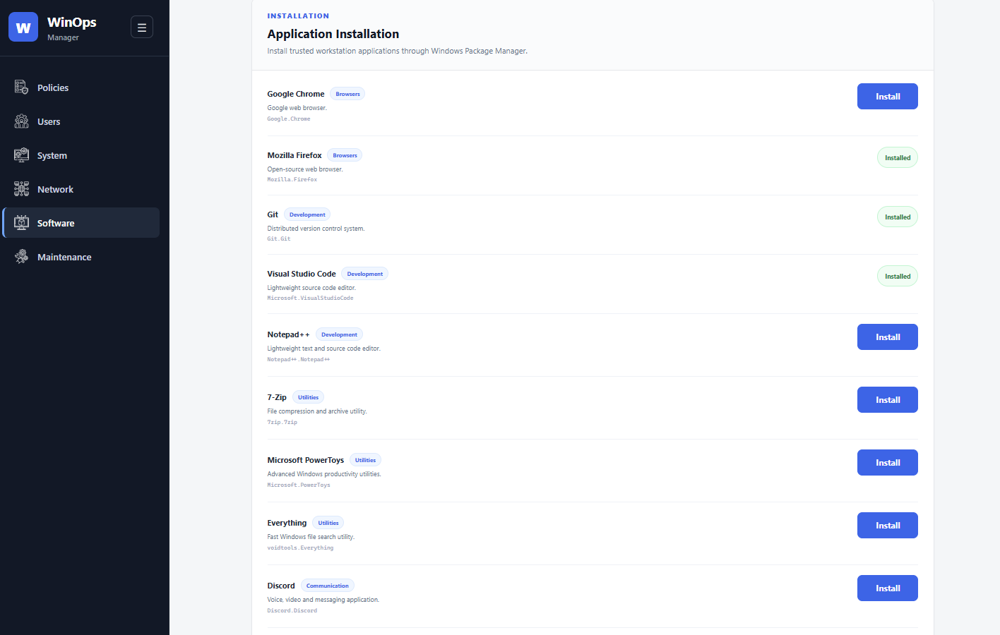
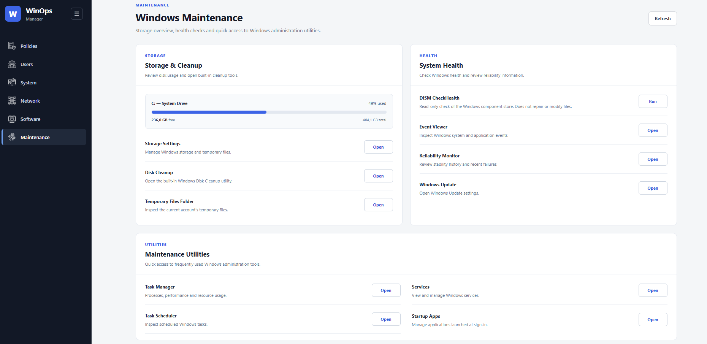

<div align="center">


# WinOps Manager

**Windows Administration • Security Policies • Performance & Maintenance**

A locally hosted Windows administration dashboard built with **Java, Spring Boot and Thymeleaf**. Manage Windows settings, local accounts, network adapters, software and maintenance tools from one interface.

   

</div>

---

## Overview

WinOps Manager provides a browser-based interface to common Windows administration tasks. It integrates with native Windows tools, **PowerShell**, **WinGet** and Microsoft's **LGPO.exe** utility. The UI includes a collapsible sidebar and progressive loading for selected data-heavy pages.

> [!WARNING]
> **Administrator-level application.** WinOps Manager can modify local users, group policies, networking, power settings and installed software. Run it **only on a trusted Windows machine**, do not expose its HTTP port to the internet or an untrusted network, and review actions before applying them. The project is not a hardened multi-user remote administration server.

## Features

| Module | Capabilities |
|---|---|
| **Policies** | Browse and apply local group policies; USB/removable storage, background apps, consumer features, storage/file system and sign-in settings; selected policies support configured values. |
| **Users** | View and manage local Windows accounts, create accounts, change settings/passwords and delete accounts with confirmation. |
| **System** | View system and hardware information; computer name, time zone, power plans, sleep/display timeout, restore and repair tools, restart/shutdown actions. |
| **Network** | Inspect adapters and IP settings; DHCP/static IP, adapter enable/disable, DNS flush, reset and network diagnostics (ping, DNS lookup, ipconfig). |
| **Software** | Inspect installed apps and updates; WinGet install, uninstall, update, update-all, source refresh and diagnostics; track ongoing operations. |
| **Maintenance** | Storage overview, Windows cleanup shortcuts, DISM health check, Event Viewer, Reliability Monitor, Services, Task Manager and related utilities. |

### Performance and usability

- Progressive page loading on **Users**, **System** and **Software**.
- Background loading and short-lived caching for network adapter details.
- Reduced repeated LGPO reads and other expensive system calls.
- Responsive navigation with persistent sidebar state and policy scroll-position restoration.
- English-language interface with a light, dashboard-style layout.

## Screenshots

### Policies

Browse and configure supported local Windows Group Policy settings.



### Users

Manage local Windows user accounts and account settings.



### System

View hardware and system information, power options, and system utilities.



### Network

Inspect and manage network adapters, IP settings, and diagnostics.



### Software

Manage installed software and Windows Package Manager operations.



### Maintenance

Access system maintenance, health-check, and troubleshooting tools.



## Technology stack

- **Backend:** Java, Spring Boot 4.1.1, Spring MVC, Maven
- **Frontend:** Thymeleaf, HTML, CSS, JavaScript
- **Windows integration:** PowerShell, Windows command-line utilities, WinGet, LGPO.exe
- **JSON:** Jackson

## Requirements

- Windows 10 or Windows 11 (Windows-specific functionality; compatibility may vary by edition/build)
- **JDK 21 or later** (the Maven project targets Java 21)
- Maven, or the included Maven Wrapper
- Windows Package Manager (`winget`) for software-management functionality
- Administrator privileges for operations that change system settings

Some group policies may not be supported by every Windows edition or build. Policies are not a universal bloatware removal tool; review the effect of each setting before enabling it.

## Getting started

1. Clone the repository:

   ```powershell
   git clone https://github.com/KonKargas/WinOps.git
   cd WinOps
   ```

2. Build the project from PowerShell:

   ```powershell
   .\mvnw.cmd clean package
   ```

3. Start the application:

   ```powershell
   .\mvnw.cmd spring-boot:run
   ```

4. Open **http://localhost:8080** in your browser.

For operations requiring elevated privileges, start the terminal **as Administrator**. Keep the application local to your trusted machine; when deploying, explicitly restrict access to localhost and consider adding authentication and CSRF protection before any broader use.

> The bundled `src/main/resources/tools/LGPO.exe` is a Microsoft utility used to read and apply local policy settings. It is **not authored by this project**; its redistribution and use remain subject to Microsoft's applicable terms.

## Project structure

```text
WinOps/
├── .mvn/wrapper/                   # Maven Wrapper configuration
├── screenshots/                    # Application screenshots
├── src/
│   ├── main/
│   │   ├── java/com/kkargas/gpm/
│   │   │   ├── controller/         # MVC and action endpoints
│   │   │   ├── model/              # Application models
│   │   │   ├── service/            # Windows integration and business logic
│   │   │   ├── config/             # App configuration
│   │   │   └── enums/
│   │   └── resources/
│   │       ├── data/               # JSON policy definitions
│   │       ├── static/             # CSS, JS and images
│   │       ├── templates/          # Thymeleaf pages and fragments
│   │       └── tools/              # LGPO utility
│   └── test/
├── pom.xml
├── mvnw
└── mvnw.cmd
```

## Safety notes

- Policy changes, user management and network changes may require elevation and can affect normal Windows behavior.
- Network changes may interrupt connectivity; avoid applying them over a remote connection without a recovery plan.
- Account deletion does not necessarily remove the corresponding Windows profile directory.
- Avoid exposing the app outside localhost; its administrative endpoints were designed for a trusted local environment.
- Back up important settings or create a restore point before significant system changes.

## Development status

The core dashboard modules are implemented. Windows behavior depends on OS edition, installed tools and privileges; test critical operations on a non-production system before using them on a primary machine.

## Author

**Konstantinos Kargas**  
Full-Stack Software Engineer

- Website: [kkargas.com](https://kkargas.com)
- GitHub: [KonKargas](https://github.com/KonKargas)

## Third-party tools

This repository includes Microsoft's **LGPO.exe** for local Group Policy integration. Microsoft retains rights to its utility. The inclusion of this executable does not imply endorsement by Microsoft. Other technologies and trademarks belong to their respective owners.
